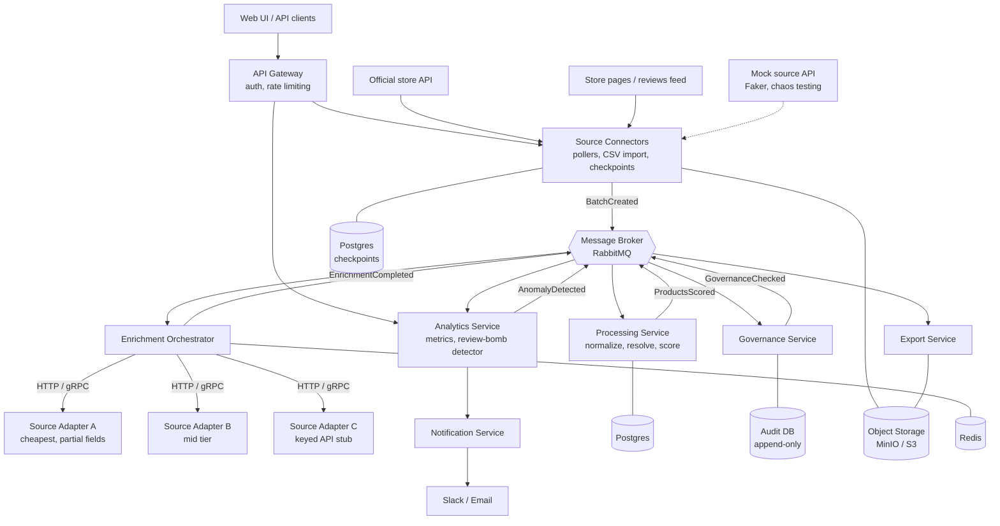

# PulseForge

**A multi-source game-store data platform built as an event-driven microservices system, with real-time review anomaly detection.**

PulseForge pulls public game-store data (product metadata, player counts, price changes, and user reviews) through pluggable source connectors, resolves the same game across sources despite edition, DLC, and bundle naming noise, enriches records through cost-aware waterfall routing, applies data-governance rules, and delivers analysis-ready datasets with a full audit trail, live performance analytics, and rule-based review-bomb alerts.

> **Data note:** PulseForge ingests real, publicly available data from official and unofficial store APIs. Raw review text and reviewer identifiers are never published in this repository or the demo; reviewer IDs are pseudonymized on ingest and gold datasets carry only aggregates. A Faker-driven mock source API is used for tests, chaos scenarios, and load testing. This project is independent and is not affiliated with or endorsed by any game store or publisher. Some endpoints used here are unofficial and can change; check each source's current terms before running it.

**Live demo:** _link here_ | **Walkthrough video:** _Loom link here_ | **Status:** _in development_

---

## Problem

Game analytics teams and community managers work with data that arrives continuously, from several sources, with inconsistent naming. The recurring failure modes:

- The same game appears under different titles across sources (editions, remasters, DLC, bundles) and gets enriched and counted more than once
- Querying every source for every record wastes API budget on fields the cheapest source already has
- Governance rules (reviewer privacy, content retention, source terms) get applied inconsistently or by deleting records, destroying the audit trail
- Review-bombing and sudden sentiment collapses are noticed by humans days after they start

PulseForge automates the full pipeline and makes each of those problems measurable.

## Key Features

- **Pull-based source connectors.** Cursor-paginated pollers with durable checkpoints replace file upload; CSV import remains as one connector among several
- **Micro-batching.** Incoming records are grouped by size or time window so resolution and routing work on batches, not single events
- **Entity resolution.** Fuzzy matching across title variations, editions, DLC, bundles, and developer/publisher name differences, collapsing results into a canonical product record
- **Controversy scoring.** Products are scored by stacked signals: review volume spikes, negative-ratio swings, player-count drops, and price or patch events
- **Review-bomb detection.** A configurable rule-based detector fires when the negative-review percentage crosses a threshold inside a rolling time window, with a minimum review count to suppress noise on small titles
- **Waterfall enrichment.** Cheapest source first; only records with missing fields cascade to the next source, tracked as API calls saved
- **Confidence scoring.** Each enriched field is scored on source agreement and recency
- **Governance gate.** Reviewer pseudonymization, content-retention limits, adult-content flags, per-source terms policy, and a suppression list. Records are flagged, never silently dropped
- **Append-only audit log.** Every governance decision is timestamped and traceable
- **Resilience.** Circuit breakers, retries with backoff and jitter, idempotency keys, a token-bucket limiter per source, and a dead-letter queue with replay
- **Observability.** Distributed tracing, metrics, and anomaly alerts (source failures, duplicate spikes, hit-rate drops, review-bomb detections)
- **Analysis-ready exports.** Standardized naming convention and column mapping for Parquet/CSV datasets and an alert feed

## Architecture



### Services

| Service | Responsibility | Datastore |
|---|---|---|
| `api-gateway` | Single entry point, JWT auth, rate limiting, routing | none |
| `source-connectors` | Polls sources by cursor, handles webhooks and CSV import, checkpoints, micro-batching, writes raw responses to bronze | Postgres, MinIO |
| `processing` | Normalization, entity resolution, signal stacking, scoring | Postgres |
| `orchestrator` | Waterfall routing, circuit breakers, retries, idempotency, token buckets, DLQ | Redis, Postgres |
| `source-adapters` | One adapter per enrichment source behind a common interface | none |
| `governance` | Pseudonymization, retention, terms policy, suppression, audit log | Postgres (append-only) |
| `export` | Naming convention and analysis-ready files | MinIO |
| `analytics` | Metrics aggregation, review-bomb and anomaly detection | Postgres |
| `notification` | Slack and email alerts | none |
| `dashboard` | Streamlit UI for sources, runs, results, and metrics | none |

**Rule:** each service owns its own database. No service reads another service's tables. Services communicate only through events or APIs.

### Source connector design

Every source implements one interface, so adding a source means writing a connector and a field mapper and nothing else:

```python
class SourceConnector(Protocol):
    name: str
    async def fetch(self, cursor: str | None) -> Page: ...

@dataclass
class Page:
    records: list[dict]      # raw payloads, untouched
    next_cursor: str | None
    has_more: bool
```

- **Checkpoints:** `(source, cursor, last_success_at)` is stored in Postgres in the same transaction as the outbox write, so a crash cannot skip or replay a page
- **Idempotency:** records are keyed on `(source, external_id, payload_hash)`; re-polling a page upserts instead of duplicating
- **Delivery models:** paginated polling is the default; a signed webhook receiver and an SSE/websocket wrapper fit the same interface
- **Micro-batching:** records accumulate until a size or time limit (default 500 records or 5 minutes), then `BatchCreated` is emitted

### Batch lifecycle

```
Poll source → Land raw (bronze) → Validate → Normalize → Resolve products → Score
           → Waterfall enrich (A → B → C) → Confidence score
           → Governance flags → Export → Metrics + alerts
```

Each stage emits an event (`BatchCreated`, `ProductsScored`, `EnrichmentCompleted`, `GovernanceChecked`, `ExportReady`). Failed records move to a dead-letter queue with the failure reason and can be replayed.

### Review-bomb detector

The detector is deliberately simple and explainable: for each product, over a rolling window, compute the share of negative reviews and fire when it crosses a threshold.

| Setting | Meaning | Example default |
|---|---|---|
| `window` | Rolling time window | 24 hours |
| `negative_threshold` | Negative-review share that triggers an alert | 70% |
| `min_reviews` | Minimum reviews in the window, to avoid noise on small titles | 100 |
| `cooldown` | Minimum time before the same product can alert again | 12 hours |

Alerts include the product, window, review count, negative share, and the baseline share for comparison. The README makes no accuracy claims for the detector; it is a transparent rule, not a model.

### Communication patterns

- **Async events** between pipeline stages
- **Sync REST/gRPC** only where an immediate response is needed (gateway to services, orchestrator to source adapters)
- **Saga pattern** for the batch lifecycle, with compensating states on failure
- **Outbox pattern** so database writes and event publishes cannot drift apart
- **Idempotent consumers** so redelivered events never double-count or re-enrich a record

### Data layers

| Layer | Contents |
|---|---|
| Bronze | Raw responses exactly as received, with source, request parameters, and fetch time; never modified |
| Silver | Normalized, deduplicated, product-resolved records with pseudonymized reviewer IDs |
| Gold | Scored, enriched, governance-flagged, analysis-ready records and aggregates |

Every gold record carries lineage back to its source batch, source response, and governance decision.

## Tech Stack

| Area | Tools |
|---|---|
| Services | Python, FastAPI, Pydantic, httpx |
| Messaging | RabbitMQ |
| Datastores | PostgreSQL, Redis, MinIO |
| Matching | pandas, rapidfuzz |
| Dashboard | Streamlit |
| Observability | OpenTelemetry, Prometheus, Grafana, structured JSON logs |
| Infrastructure | Docker, Docker Compose, Kubernetes manifests |
| CI/CD | GitHub Actions (per-service pipelines with path filters) |
| Testing | pytest, Testcontainers, Locust |
| Test data | Faker (mock source API) |

## Getting Started

### Prerequisites

- Docker and Docker Compose
- Python 3.11+ (for local development and the mock source)
- Optional: an official store API key, placed in `.env` as `STORE_API_KEY`

### Run the full stack

```bash
git clone https://github.com/<your-username>/pulseforge.git
cd pulseforge

cp .env.example .env

# Generate mock-source data (with deliberate duplicates, edition noise, and review spikes)
python tools/generate_data.py --records 5000 --out sample_data/

# Start everything
docker compose up --build
```

### Endpoints

| Component | URL |
|---|---|
| Dashboard | http://localhost:8501 |
| API gateway | http://localhost:8000 |
| API docs (OpenAPI) | http://localhost:8000/docs |
| RabbitMQ console | http://localhost:15672 |
| Grafana | http://localhost:3000 |
| MinIO console | http://localhost:9001 |

### Try it

1. Open the dashboard
2. Enable the mock source (or a real connector if you added a key)
3. Watch micro-batches move through each stage
4. Trigger a simulated review-bomb from the mock source and watch the alert fire
5. Download the analysis-ready export and review the audit log and metrics

## Repository Layout

```
/services
  /api-gateway
  /source-connectors
  /processing
  /orchestrator
  /source-adapters
  /governance
  /export
  /analytics
  /notification
  /dashboard
  /mock-source        Faker-driven source API with pagination, errors, and spikes
/libs                 shared schemas and event contracts
/infra
  /k8s                Kubernetes manifests
  docker-compose.yml
/tools                data generator, load test scripts
/docs
  /adr                architecture decision records
  architecture.md
/tests
  /e2e
.github/workflows     per-service CI pipelines
```

## Architecture Decision Records

Key decisions and their tradeoffs live in [`/docs/adr`](docs/adr):

| ADR | Decision |
|---|---|
| 001 | Waterfall source routing instead of parallel calls (API budget vs. latency) |
| 002 | Microservices over a modular monolith (independent scaling, isolated governance auditing, and honest tradeoffs) |
| 003 | Flag-and-tombstone for governance records instead of deletion |
| 004 | Event-driven pipeline with RabbitMQ over synchronous calls |
| 005 | Append-only audit log |
| 006 | Idempotency keys and the outbox pattern |
| 007 | Pull-based connectors with micro-batching vs. per-record streaming |
| 008 | Rule-based review-bomb detection over a learned model |

## Resilience Design

| Failure | Behavior |
|---|---|
| Source starts erroring | Circuit breaker opens, waterfall skips to the next source, source is re-tested periodically |
| Transient failure | Retry with exponential backoff and jitter |
| Source returns 429 or throttles | Token bucket slows polling and honors `Retry-After` |
| Record fails repeatedly | Moves to the dead-letter queue with the reason; replay tool available |
| Page re-polled | Idempotency keys prevent duplicate records and duplicate enrichment calls |
| Queue lag grows | Connectors pause polling until downstream consumers catch up |
| All sources down | Batch pauses and resumes when a source recovers |
| Service crash mid-batch | Event redelivery plus idempotent consumers; saga moves the batch to a compensating state if needed |

## Governance Notes

- Reviewer identifiers are pseudonymized with a salted hash on ingest; raw identifiers are not retained in silver or gold
- Review text is used for sentiment aggregation and is not stored in gold datasets or exported
- Records are flagged and retained, never silently dropped. Erasure requests purge content and leave a tombstone plus the audit entry, so every decision stays traceable
- Per-source policies record each source's terms and enforce limits on what may be stored
- A scheduled job re-checks active records against the suppression list every 30 days
- These rules are illustrative and not legal advice; a production deployment needs review against each source's current terms and applicable privacy law

## Observability

- **Tracing:** a correlation ID follows each batch through every service (OpenTelemetry)
- **Metrics:** queue lag, per-source hit rate, error rate, API calls per enriched record, duplicate rate, detector alerts
- **Alerts:** hit-rate drops, consumer lag, circuit breaker trips, unusual duplicate spikes, and review-bomb detections route to Slack or email
- **Health:** every service exposes `/health` and `/ready`

## Testing

```bash
# Unit tests for a service
cd services/orchestrator && pytest

# Integration tests (spins up real Postgres and RabbitMQ with Testcontainers)
pytest tests/integration

# End-to-end (uses the mock source, including a scripted review-bomb)
pytest tests/e2e

# Load test
locust -f tools/load_test.py
```

## Performance

_Fill in after load testing._

| Metric | Result |
|---|---|
| 5,000-record batch, end to end | _X seconds_ |
| Waterfall API calls vs. querying every source | _X% fewer_ |
| Dedupe reduction on collected data | _X% of records collapsed_ |
| Entity resolution precision/recall on a hand-labeled sample | _X / Y_ |
| Throughput at N orchestrator workers | _X records/sec_ |
| Detector latency, review arrival to alert | _X seconds_ |

## Running a Live Demo

The full stack fits on a single VM (roughly 4 vCPU and 8 GB RAM) running `docker compose` behind HTTPS. Keep the dashboard behind basic auth and the broker and Grafana admin ports private. The Kubernetes manifests are included for reference and are not required for the demo. A recorded walkthrough keeps the project demonstrable when the VM is off.

## Roadmap

- [ ] Mock source API with pagination, errors, duplicates, and review spikes
- [ ] Shared schemas and event contracts
- [ ] Source connector framework (interface, checkpoints, micro-batching)
- [ ] First real connector (official store API)
- [ ] Processing service (normalize, resolve, score)
- [ ] Orchestrator with mock sources, waterfall, retries, idempotency
- [ ] Governance service and audit log
- [ ] Review-bomb detector with configurable thresholds
- [ ] Docker Compose for the full stack
- [ ] Dashboard
- [ ] Analytics and anomaly alerts
- [ ] API gateway and auth
- [ ] Tracing and metrics (OpenTelemetry, Prometheus, Grafana)
- [ ] CI/CD per service
- [ ] Kubernetes manifests
- [ ] Load test and published results
- [ ] Additional real sources (Wikidata, IGDB) beyond the stub

## Author

**Your Name**
[LinkedIn](#) | [Portfolio](#) | [Email](#)

## License

MIT
